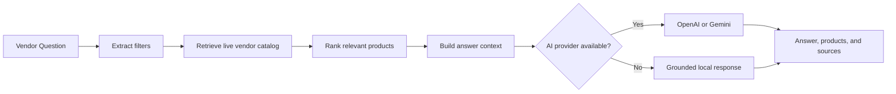

# 🛍️ ShopSense

> **A RAG-powered vendor marketplace for catalog management, inventory insights, and marketplace analytics.**

[](https://www.python.org/)
[](https://fastapi.tiangolo.com/)
[](https://react.dev/)
[](https://vite.dev/)
[](https://www.sqlite.org/)
[](#-license)

---

## ✨ Overview

ShopSense brings vendors and administrators into one modern marketplace platform.

- **Vendors** can manage a catalog, update inventory, view sales insights, and use an AI Business Assistant.
- **Administrators** can review vendors, approve accounts, suspend stores, and monitor marketplace activity.
- **The AI assistant** retrieves the signed-in vendor's live catalog before generating or grounding a response.

---

## 🎯 Key Features

### 🏪 Vendor Workspace

| Feature | Description |
| :--- | :--- |
| **Dashboard** | Store totals, catalog health, and important product metrics |
| **Catalog** | Search, filter, switch views, edit, remove, or create products |
| **Inventory** | Track stock levels and receive inventory notifications |
| **Product Editor** | Add images, descriptions, SEO fields, categories, prices, and stock |
| **Insights** | View sales, demand, customer, market, and inventory reports |
| **AI Business Assistant** | Ask questions grounded in the vendor's own live catalog |
| **Profile** | Manage account and business information |

### 🛡️ Administrator Workspace

- Approve, suspend, reset, or remove vendor accounts
- Review vendor status and marketplace-wide vendor counts
- Bootstrap the first administrator securely
- Control whether registrations are auto-approved

### 🤖 Retrieval-Augmented Generation

The AI Business Assistant uses a local retrieval pipeline:



- Vendor results are always scoped to the signed-in vendor
- Supports category, price, stock, count, and catalog lookup questions
- OpenAI is tried before Gemini
- A grounded local response is used when no provider is available

---

## 🧰 Technology Stack

| Layer | Technologies |
| :--- | :--- |
| **Frontend** | React 19, React Router 7, Vite 8, Tailwind CSS 4 |
| **Backend** | Python, FastAPI, Uvicorn, Pydantic |
| **Database** | SQLite with automatic migrations and dataset import |
| **Authentication** | Bearer JWT and bcrypt password hashing |
| **AI Providers** | OpenAI API and Google Gemini API through HTTPX |
| **Deployment** | Docker, Docker Compose, Render |
| **Testing** | Python unittest/pytest-style API tests and JavaScript health tests |

---

## 📁 Project Structure

```text
shopsense/
├── client/                  # React and Vite frontend
│   ├── public/              # Static public assets
│   └── src/
│       ├── components/      # Shared UI components
│       ├── context/         # Authentication state
│       ├── lib/             # API, currency, and image helpers
│       └── pages/
│           ├── admin/       # Administrator workspaces
│           └── vendor/      # Vendor workspaces
├── analytics_api/           # FastAPI application
│   ├── auth_routes.py       # Login, registration, and bootstrap
│   ├── admin_routes.py      # Administrator operations
│   ├── vendor_routes.py     # Vendor and catalog operations
│   ├── market_analytics_routes.py
│   ├── ai_rag.py            # RAG retrieval and content generation
│   └── database.py          # SQLite setup and migrations
├── dataset/                 # Historical XLSX source data
├── scripts/                 # Local startup and test launchers
├── server/
│   ├── db/                  # SQLite database
│   └── uploads/             # Uploaded product images
├── Dockerfile
├── docker-compose.yml
└── package.json             # Root project commands
```

---

## ⚡ Quick Start on Windows

### Prerequisites

- Windows 10 or 11
- Python 3.10 or newer
- Node.js 20 or newer
- npm

### 1. Clone and enter the project

```powershell
git clone https://github.com/amulya-munugoti/shopsense.git
cd shopsense
```

### 2. Create the Python environment

```powershell
py -3 -m venv .venv
.\.venv\Scripts\python.exe -m pip install --upgrade pip
.\.venv\Scripts\python.exe -m pip install -r analytics_api\requirements-dev.txt
```

### 3. Install frontend dependencies

```powershell
npm install --prefix client
```

### 4. Configure environment variables

```powershell
Copy-Item .env.example .env
```

Set at minimum:

```dotenv
APP_ENV=development
JWT_SECRET=replace-with-a-private-secret-at-least-32-characters
AUTO_APPROVE_VENDORS=true
```

To automatically create initial accounts:

```dotenv
BOOTSTRAP_ADMIN_EMAIL=admin@yourdomain.com
BOOTSTRAP_ADMIN_NAME=ShopSense Administrator
BOOTSTRAP_ADMIN_PASSWORD=UseAUniquePassword12!

BOOTSTRAP_VENDOR_EMAIL=vendor@yourdomain.com
BOOTSTRAP_VENDOR_NAME=Demo Vendor
BOOTSTRAP_VENDOR_BUSINESS_NAME=Demo Store
BOOTSTRAP_VENDOR_PASSWORD=UseAnotherUniquePassword12!
```

### 5. Start everything

```powershell
npm run local
```

The combined launcher starts:

| Service | Address |
| :--- | :--- |
| 🖥️ Web application | http://127.0.0.1:5173 |
| ⚙️ API | http://127.0.0.1:8000 |
| 📚 Interactive API docs | http://127.0.0.1:8000/docs |
| ❤️ Health check | http://127.0.0.1:8000/health |

Press `Ctrl+C` to stop both services.

---

## 🖥️ Running Services Separately

### API only

```powershell
npm run dev
```

Or without reload mode:

```powershell
npm start
```

### Frontend only

```powershell
npm run dev --prefix client
```

Keep the API running at `http://127.0.0.1:8000`.

### macOS or Linux

```bash
python3 -m venv .venv
.venv/bin/python -m pip install -r analytics_api/requirements-dev.txt
npm install --prefix client
npm run local
```

---

## 🔐 Demo and Bootstrap Accounts

### Automatic bootstrap

Configure the `BOOTSTRAP_*` variables described above. Bootstrap accounts are created only when the relevant account tables are empty.

### Optional manual bootstrap endpoints

With the API running:

```powershell
Invoke-RestMethod -Method Post -Uri http://127.0.0.1:8000/api/auth/bootstrap-admin
Invoke-RestMethod -Method Post -Uri http://127.0.0.1:8000/api/auth/bootstrap-vendor
```

### Public demo defaults

In local development or when demo accounts are enabled, the application may use:

| Role | Email | Password |
| :--- | :--- | :--- |
| Administrator | `admin@demo.com` | `admin123` |
| Vendor | `vendor@demo.com` | `vendor123` |

> ⚠️ Demo credentials are public and must not be used in production. Set `ENABLE_DEMO_ACCOUNTS=false` for production deployments.

New vendor accounts require administrator approval unless `AUTO_APPROVE_VENDORS=true`.

---

## 🐳 Docker

Docker Compose runs the API. Start the frontend separately.

```powershell
Copy-Item .env.example .env
docker compose up --build
npm run dev --prefix client
```

Docker exposes the API at `http://127.0.0.1:8000`.

---

## 🧪 Tests and Quality Checks

Run all configured checks:

```powershell
npm test
npm run lint --prefix client
npm run build --prefix client
```

The frontend build is generated in:

```text
client/dist/
```

---

## ⚙️ Configuration Reference

| Variable | Purpose |
| :--- | :--- |
| `APP_ENV` | Set to `development` or `production` |
| `JWT_SECRET` | Signs bearer tokens; use at least 32 private characters in production |
| `PYTHON_API_PORT` | API port, default `8000` |
| `CLIENT_ORIGIN` | Additional frontend origin allowed by CORS |
| `DB_PATH` | SQLite database location |
| `AUTO_APPROVE_VENDORS` | Automatically approve newly registered vendors |
| `ENABLE_DEMO_ACCOUNTS` | Enable or disable built-in demo accounts |
| `BOOTSTRAP_ADMIN_*` | Initial administrator account configuration |
| `BOOTSTRAP_VENDOR_*` | Initial vendor account configuration |
| `DEMO_ADMIN_*` | Optional demo administrator overrides |
| `DEMO_VENDOR_*` | Optional demo vendor overrides |
| `OPENAI_API_KEY` | Optional OpenAI answer generation |
| `GEMINI_API_KEY` | Optional Gemini answer generation |
| `VITE_API_URL` | API URL used by a separately hosted frontend |
| `VITE_API_PROXY_TARGET` | Vite development proxy target |

---

## 🌐 API Overview

| Route Group | Capabilities |
| :--- | :--- |
| `/api/auth/*` | Registration, login, and account bootstrap |
| `/api/vendor/*` | Dashboard, catalog, profile, stock, and uploads |
| `/api/admin/*` | Vendor dashboard and account management |
| `/api/analytics/*` | Sales, inventory, forecasts, benchmarks, and exports |
| `/api/ai/*` | AI assistant and product content generation |

Protected routes require a JWT bearer token. Vendor data is restricted to the signed-in vendor, and administrator routes require an administrator account.

---

## 🚀 Deployment

The repository includes:

- `Dockerfile` for the FastAPI service
- `docker-compose.yml` for the API container
- `render.yaml` for a Render API and static frontend deployment

For Render, configure private bootstrap credentials and JWT settings in the service environment. The static frontend must receive the deployed API URL through `VITE_API_URL`.

---

## 📄 License

**ALL RIGHTS RESERVED BY AMULYA MUNUGOTI**
