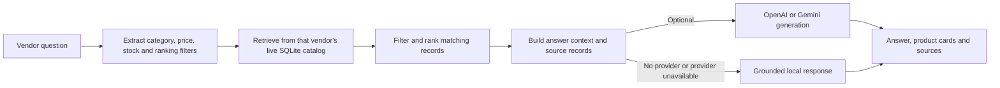
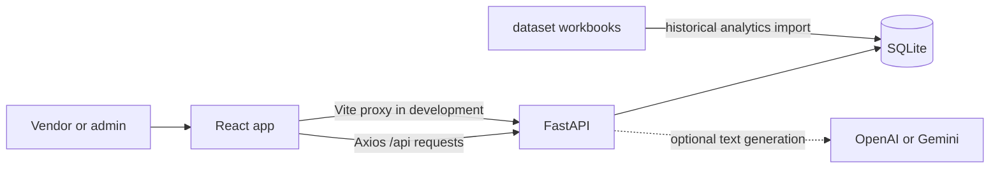

# ShopSense

**A RAG-powered vendor catalog and inventory platform.** ShopSense combines vendor and admin workspaces with marketplace analytics. Its Retrieval-Augmented Generation (RAG) feature is presented in the product as the **AI Business Assistant**: it retrieves relevant records from a vendor's live catalog before answering.

## Contents

- [Workflows](#workflows)
- [Features](#features)
- [Architecture](#architecture)
- [Project structure](#project-structure)
- [Technology](#technology)
- [Run locally](#run-locally)
- [Configuration](#configuration)
- [Build, lint, and tests](#build-lint-and-tests)
- [API reference](#api-reference)

## Workflows

### Vendor

```text
Register → Wait for admin approval → Sign in → Manage catalog and stock
                                      ├→ Review Insights
                                      └→ Ask the AI Business Assistant
```

Vendors register from the sign-in page. New accounts have **pending** status and cannot sign in until an administrator approves them.

### Admin

```text
Bootstrap the first admin → Sign in → Review vendor accounts
                                      ├→ Approve or suspend
                                      ├→ Reset status to pending
                                      └→ Remove a vendor
```

## Features

| Workspace | What is implemented |
| --- | --- |
| Vendor dashboard | Store totals and catalog product cards |
| My catalog | Search, category and stock filters, grid/list views, product details, edit and remove |
| Add product | Product details, category, price, stock, image upload or image URL, description and optional SEO fields |
| Insights | Sales reports, inventory health, customer and product reports, demand projections, vendor/marketplace benchmarks, cross-sell reports, dataset validation, CSV exports |
| RAG / AI Business Assistant | The screen is titled **AI Business Assistant**. Its RAG pipeline retrieves relevant records from the signed-in vendor's live catalog before answering. |
| Admin dashboard | Vendor counts and recent vendor accounts |
| Vendor management | Filter by account status; approve, suspend, reset status, or remove vendors |
| Profile | Edit account and business details or change the password |

Product description and SEO generation use the product name, category, and optional vendor-provided facts. OpenAI and Gemini are optional providers; the API has a grounded local fallback when a provider is not available.

## RAG: how the AI Business Assistant works

RAG means **Retrieval-Augmented Generation**. ShopSense retrieves vendor catalog records first, then uses those records as evidence for an answer. Every vendor request is scoped to the signed-in vendor's own products.



The retriever reads current SQLite catalog rows for each question. It applies supported category, price, and stock constraints, then ranks matches using exact/lexical matching and a small hashed token and character n-gram vector. It does not depend on an external vector database. Follow-up questions can include recent product results as context.

Count, stock, and direct catalog lookup questions can be answered directly from retrieved records. Other questions can be sent to the configured text provider with vendor catalog context (up to 200 products) and relevant matches beyond that limit. If no provider is available, local handling supports catalog filters and states when the catalog does not contain enough information. Responses include matching product cards and source details when there are matches.

## Architecture



- **Frontend:** React routes provide the vendor and admin workspaces. Protected routes require the appropriate signed-in role.
- **API:** FastAPI handles authentication, role checks, vendor and admin operations, analytics, image uploads, and AI endpoints.
- **Database:** SQLite stores vendor accounts, catalog products, vendor sales, and historical analytics tables. `DB_PATH` can change the database file location.
- **Historical data:** `dataset/` contains product, customer, order, and order-item workbooks. During database initialization, they are imported if `analytics_orders` is empty and all four files are present. Vendor catalog and sales data use separate tables.
- **Business Assistant:** retrieval reads the signed-in vendor's live catalog. External providers can generate a conversational answer; local handling supports catalog filters and reports when catalog information is missing.
- **Local web requests:** Vite proxies `/api` and `/uploads` to FastAPI. The API accepts paths with or without the `/api` prefix.

## Project structure

```text
shopsense/
├── client/                         React and Vite application
│   ├── public/                      Static assets
│   ├── vite.config.js               Vite plugins and development proxy
│   └── src/
│       ├── App.jsx                  Routes and protected workspaces
│       ├── components/              Shared layout, dialogs, badges and images
│       ├── context/                 Authentication state
│       ├── lib/                     API client and display helpers
│       └── pages/
│           ├── admin/               Admin dashboard and vendor management
│           └── vendor/              Dashboard, catalog, product form, insights, assistant, profile
├── analytics_api/                   FastAPI backend and Python tests
│   ├── main.py                      App setup and AI/summary endpoints
│   ├── auth_routes.py               Registration, login, admin bootstrap
│   ├── admin_routes.py              Admin vendor operations
│   ├── vendor_routes.py             Vendor profile, catalog, stock and image APIs
│   ├── market_analytics_routes.py   Marketplace and vendor analytics
│   ├── ai_rag.py                    Catalog retrieval and product content generation
│   ├── database.py                  SQLite schema, migrations and workbook import
│   └── requirements*.txt            Python dependencies
├── dataset/                         Historical XLSX source files
├── scripts/                         Local startup and test launchers
├── server/                          Runtime SQLite database and uploaded images
├── Dockerfile                       FastAPI container image
├── docker-compose.yml               API container and persistent data mounts
├── .env.example                     Environment variable template
└── package.json                     Root startup and test commands
```

## Technology

| Layer | Stack |
| --- | --- |
| Frontend | React 19, React Router 7, Vite 8 |
| UI | Tailwind CSS 4, project CSS, lucide-react |
| Backend | Python 3, FastAPI, Uvicorn, Pydantic |
| Data | SQLite, Python `sqlite3`, openpyxl for XLSX import |
| Authentication | Bearer JWTs (`python-jose`), bcrypt password hashes |
| Optional text generation | OpenAI API and Google Gemini API via HTTPX |

## Run locally

### 1. Install dependencies

From the repository root on Windows:

```powershell
py -3 -m venv .venv
.\.venv\Scripts\python.exe -m pip install -r analytics_api\requirements-dev.txt
npm install --prefix client
```

On macOS or Linux, create the environment with `python3 -m venv .venv`; use `.venv/bin/python` for Python commands.

### 2. Configure `.env`

```powershell
Copy-Item .env.example .env
```

For local development, set `APP_ENV=development` and a private `JWT_SECRET`. Configure `BOOTSTRAP_ADMIN_EMAIL` and `BOOTSTRAP_ADMIN_PASSWORD` to create the first admin. The password must be 12–72 bytes; `BOOTSTRAP_ADMIN_NAME` is optional. Do not commit `.env`.

### 3. Start the app

```powershell
npm run local
```

Open <http://localhost:5173>. The API runs on port `8000` by default. Keep the terminal open while using the app; press `Ctrl+C` to stop both services.

### 4. Create the first admin and an initial approved vendor

Set `BOOTSTRAP_ADMIN_EMAIL`, `BOOTSTRAP_ADMIN_PASSWORD`, `BOOTSTRAP_VENDOR_EMAIL`, and `BOOTSTRAP_VENDOR_PASSWORD` in the API environment. Both passwords must be 12–72 bytes. On API startup, the first admin and an approved initial vendor are created automatically if their account tables are empty. The vendor name and business name are optional.

```powershell
# Optional manual bootstrap endpoints, if you prefer to create accounts after startup:
Invoke-RestMethod -Method Post -Uri http://127.0.0.1:8000/api/auth/bootstrap-admin
Invoke-RestMethod -Method Post -Uri http://127.0.0.1:8000/api/auth/bootstrap-vendor
```

The administrator and approved vendor can then sign in with their configured credentials. Additional vendor registrations still require administrator approval.

For Render, set the bootstrap values under the `shopsense-api` service's environment settings and deploy. Startup creates the accounts automatically. Keep the passwords private and use different values for the two accounts.

### Run services separately

- API only: `npm run dev` from the repository root. `npm start` runs it without reload mode.
- Frontend only: `npm run dev` from `client`; keep the API running in another terminal.
- Docker: the root `Dockerfile` and `docker-compose.yml` run the **API only**. Copy `.env.example` to `.env`, configure a private production `JWT_SECRET` of at least 32 bytes, then run `docker compose up --build`. Start the frontend separately with `npm run dev --prefix client`.

## Configuration

The Python API reads the root `.env` and can also read `server/.env`. Keep provider keys and credentials out of source control.

| Variable | Use |
| --- | --- |
| `APP_ENV` | Set to `development` for local demo-account seeding. |
| `JWT_SECRET` | Signs bearer tokens. In production, use a private value of at least 32 bytes. |
| `PYTHON_API_PORT` | API port; default `8000`. |
| `CLIENT_ORIGIN` | Additional frontend origin allowed by API CORS. |
| `DB_PATH` | SQLite file path; default `server/db/shopsense.db`. |
| `BOOTSTRAP_ADMIN_EMAIL` | Initial admin email. |
| `BOOTSTRAP_ADMIN_NAME` | Optional initial admin name. |
| `BOOTSTRAP_ADMIN_PASSWORD` | Initial admin password, 12–72 bytes. |
| `BOOTSTRAP_VENDOR_EMAIL`, `BOOTSTRAP_VENDOR_PASSWORD` | Initial approved vendor credentials. |
| `BOOTSTRAP_VENDOR_NAME`, `BOOTSTRAP_VENDOR_BUSINESS_NAME` | Optional initial vendor profile values. |
| `DEMO_ADMIN_EMAIL`, `DEMO_ADMIN_PASSWORD` | Optional demo admin; development only. |
| `DEMO_VENDOR_EMAIL`, `DEMO_VENDOR_PASSWORD` | Optional approved demo vendor; development only. |
| `OPENAI_API_KEY` | Optional OpenAI provider; tried before Gemini. |
| `GEMINI_API_KEY` | Optional Gemini provider/fallback. |
| `LLM_API_KEY` | Legacy Gemini key alias used if `GEMINI_API_KEY` is unset. |
| `VITE_API_PROXY_TARGET` | Vite development proxy target; default `http://127.0.0.1:8000`. |
| `VITE_API_URL` | Optional API base URL when frontend and API are hosted separately. |

Email verification is not part of the current registration flow. New vendors require admin approval before login. Optional demo accounts are seeded only when `APP_ENV=development`.

## Build, lint, and tests

Run from the repository root:

```powershell
npm run build --prefix client
npm run lint --prefix client
npm test
```

The production frontend output is written to `client/dist/`. `npm test` runs the Python API test suite; install `analytics_api/requirements-dev.txt` first.

## API reference

With the API running, open FastAPI's interactive documentation at <http://127.0.0.1:8000/docs>. `GET /health` is the health check. The frontend uses the `/api` prefix for API requests.

| Area | Main route groups |
| --- | --- |
| Accounts | `/api/auth/*` — register, login, bootstrap the first admin |
| Vendor workspace | `/api/vendor/*` — dashboard, catalog, profile, inventory, images |
| Admin workspace | `/api/admin/*` — dashboard and vendor management |
| Insights | `/api/analytics/*` — sales, inventory, forecasts, benchmarks, recommendations, exports |
| AI Business Assistant and product content | `/api/ai/*` — assistant requests, description/SEO generation, status |

Protected API routes require a bearer token. Vendor routes are scoped to the signed-in vendor; admin routes require an administrator account.

ALL RIGHTS RESERVED BY AMULYA MUNUGOTI
