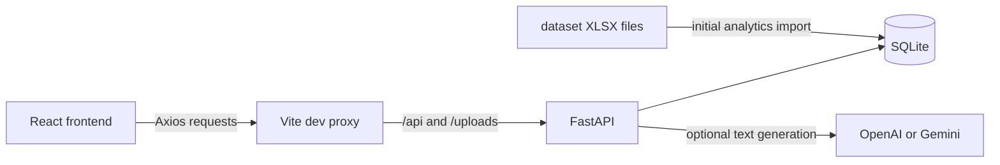

# ShopSense

ShopSense is a vendor catalog and inventory management application with marketplace analytics and an admin area. Vendors manage products, stock, and account details; admins review vendor applications and manage vendor status.

## Product workflow

### Vendor

1. Register with a vendor account. New vendor accounts are pending until an admin approves them.
2. Sign in and open the vendor dashboard to view store totals and catalog products.
3. Use **My Catalog** to search and filter products by category and stock status. Switch between grid and list views, open product details, edit products, or remove them.
4. Use **Add product** to enter product information, pricing, and stock. Product images can be uploaded; product details also support an image URL. Optional verified details can be supplied to the description generator. Optional SEO fields can be edited or generated.
5. Use **Insights** for sales and inventory reporting, demand projections, customer and product reports, marketplace benchmarks, cross-sell insights, dataset validation, and CSV exports.
6. Use **AI Assistant** to ask questions about products and inventory in your vendor catalog. The page title is **AI Business Assistant**; it uses the signed-in vendor's catalog as its source.
7. Use **Profile** to edit account and business details or set a new password.

### Admin

1. Sign in with an administrator account.
2. Use **Admin dashboard** to review vendor counts and recent vendor accounts.
3. Use **Vendor management** to filter by pending, approved, or suspended status. Approve or suspend vendors, reset a status to pending, or remove a vendor and its catalog data.

## Project structure

```text
shopsense/
├── client/                       React and Vite frontend
│   ├── public/                    Static public assets
│   ├── vite.config.js             Vite plugins and local API proxy
│   └── src/
│       ├── App.jsx                Application routes and protected areas
│       ├── components/            Shared layout, dialogs, status and image components
│       ├── context/               Authentication context
│       ├── lib/                   API client, currency and image URL helpers
│       └── pages/
│           ├── admin/             Admin dashboard and vendor management
│           └── vendor/            Dashboard, catalog, product form, insights, assistant, profile
├── analytics_api/                 FastAPI application and Python tests
│   ├── main.py                    App setup, authentication dependencies, AI and summary routes
│   ├── auth_routes.py             Registration, login, admin bootstrap
│   ├── admin_routes.py            Admin dashboard and vendor status/removal
│   ├── vendor_routes.py           Vendor profile, catalog, stock and image APIs
│   ├── market_analytics_routes.py Marketplace and vendor analytics APIs
│   ├── ai_rag.py                  Catalog retrieval and product content generation
│   ├── database.py                SQLite schema, migrations and workbook import
│   └── requirements*.txt          Python dependencies
├── dataset/                       products, customers, orders and order items workbooks
├── scripts/                       API, combined app and test launchers
├── server/                        Runtime SQLite database and uploaded images
├── Dockerfile                     API container image
├── docker-compose.yml             API container configuration
├── .env.example                   Environment variable template
└── package.json                   Root API, local-app and test commands
```

## Technology stack

| Area | Technology in this project |
| --- | --- |
| Frontend | React 19, React Router 7, Vite 8 |
| Styling | Tailwind CSS 4 and project CSS in `client/src/index.css` |
| Icons | `lucide-react` |
| API | Python 3, FastAPI, Uvicorn, Pydantic |
| Database | SQLite using Python's `sqlite3` module |
| Authentication | JWT with `python-jose`; password hashes with `bcrypt` |
| Workbook import | `openpyxl` |
| Optional text generation | OpenAI API and Google Gemini API via HTTP requests |

## Request and data flow



## Application architecture and data

- The React app sends requests through the Axios client in `client/src/lib/api.js`.
- During local development, Vite proxies `/api` and `/uploads` to the FastAPI service. The API accepts routes with or without the `/api` prefix.
- FastAPI owns authentication, authorization, vendor and admin operations, product image uploads, analytics, and AI endpoints.
- SQLite stores vendor accounts, products, sales, and historical analytics tables. `DB_PATH` can point to a different SQLite file.
- The analytics import reads `products_1.xlsx`, `customers_1.xlsx`, `orders_1.xlsx`, and `order_items_1.xlsx` from `dataset/`. It runs during database initialization when `analytics_orders` is empty and all four files are present.
- Vendor catalog and sales tables are separate from the historical analytics tables. The AI Business Assistant retrieves from the signed-in vendor's live catalog.
- OpenAI and Gemini are optional. When no provider is configured or a generation request fails, the API's product content functions use a local fallback; the Assistant can answer supported catalog filters locally. Provider-generated answers require a working API key with access to the configured model.

Registration does not send email verification messages. Newly registered vendors remain pending until an administrator approves them. Passwords are hashed by the API; authenticated API calls use bearer JWTs.

## Run locally

### Requirements

- Node.js
- Python 3

### Install dependencies

Run these commands from the repository root on Windows:

```powershell
py -3 -m venv .venv
.\.venv\Scripts\python.exe -m pip install -r analytics_api\requirements-dev.txt
npm install --prefix client
```

On macOS or Linux, create the virtual environment with `python3 -m venv .venv` and use `.venv/bin/python` for Python commands.

### Configure the environment

Create the local environment file:

```powershell
Copy-Item .env.example .env
```

For local development, set `APP_ENV=development` and set a private `JWT_SECRET`. To create the first administrator, set `BOOTSTRAP_ADMIN_EMAIL` and `BOOTSTRAP_ADMIN_PASSWORD`; the password must be 12–72 bytes. `BOOTSTRAP_ADMIN_NAME` is optional. Keep `.env` private and do not commit it.

The shipped `.env.example` uses placeholder production values. Replace those values before starting the API. In production, `JWT_SECRET` must be at least 32 bytes and cannot be the development fallback.

Optional local demo accounts can be seeded by setting `APP_ENV=development` plus both email and password variables for each account: `DEMO_ADMIN_EMAIL`, `DEMO_ADMIN_PASSWORD`, `DEMO_VENDOR_EMAIL`, and `DEMO_VENDOR_PASSWORD`.

### Start the app

From the repository root:

```powershell
npm run local
```

This starts FastAPI and Vite together. Open <http://localhost:5173>. The API defaults to <http://127.0.0.1:8000>. Leave the terminal open while using the app; press `Ctrl+C` to stop both processes.

If bootstrap credentials are configured, create the first administrator once after starting the API:

```powershell
Invoke-RestMethod -Method Post -Uri http://127.0.0.1:8000/api/auth/bootstrap-admin
```

Register a vendor in the app, sign in as the administrator, and approve the vendor under **Vendor management**. The approved vendor can then sign in.

### Run services separately

- API only: `npm run dev` from the repository root. `npm start` starts it without reload mode.
- Frontend only: `npm run dev` from `client`. Start the API separately for API requests to work.
- Frontend production build: `npm run build --prefix client` from the repository root. Build output goes to `client/dist/`.
- Frontend lint: `npm run lint --prefix client`.
- Python API tests: `npm test` from the repository root, or `\.venv\Scripts\python.exe -m pytest -q analytics_api` on Windows.

### Docker

The root `Dockerfile` and `docker-compose.yml` run the FastAPI service, not the React frontend. Copy `.env.example` to `.env`, set a private `JWT_SECRET` of at least 32 bytes and the required production values, then run `docker compose up --build`. The Compose file persists the API database and uploaded images under `server/`. Run the frontend separately with `npm run dev --prefix client` if you want the browser app alongside the API container.

## AI provider configuration

Set either `OPENAI_API_KEY` or `GEMINI_API_KEY` in the root `.env` file to enable external text generation for the AI Business Assistant and product description/SEO generation. If both are configured, the API tries OpenAI first and Gemini second. Without a working provider, fallback behavior depends on the endpoint: the Assistant handles supported catalog filters locally, while product content generation returns a grounded local result.

A ChatGPT subscription does not itself provide an OpenAI API key or API access.

## Environment variables

| Variable | Purpose |
| --- | --- |
| `APP_ENV` | Runtime environment; `development` enables optional local demo-account seeding. |
| `JWT_SECRET` | Secret used to sign authentication tokens. Set a private value for your environment. |
| `PYTHON_API_PORT` | API port; defaults to `8000`. |
| `CLIENT_ORIGIN` | Additional frontend origin accepted by API CORS. |
| `DB_PATH` | SQLite database location; defaults to `server/db/shopsense.db`. |
| `BOOTSTRAP_ADMIN_EMAIL` | Email for the initial admin bootstrap request. |
| `BOOTSTRAP_ADMIN_NAME` | Optional name for the initial administrator. |
| `BOOTSTRAP_ADMIN_PASSWORD` | Initial admin password, 12–72 bytes. |
| `DEMO_ADMIN_EMAIL`, `DEMO_ADMIN_PASSWORD` | Optional demo admin; local development only. |
| `DEMO_VENDOR_EMAIL`, `DEMO_VENDOR_PASSWORD` | Optional approved demo vendor; local development only. |
| `OPENAI_API_KEY` | Optional OpenAI text generation provider. |
| `GEMINI_API_KEY` | Optional Gemini text generation provider/fallback. |
| `LLM_API_KEY` | Legacy alias used when `GEMINI_API_KEY` is not set. |
| `HOST` | API bind host; defaults to `0.0.0.0`. |
| `VITE_API_PROXY_TARGET` | Vite development proxy target; defaults to `http://127.0.0.1:8000`. |
| `VITE_API_URL` | Optional frontend API base URL for a separately hosted API. Leave unset for same-origin `/api` requests through the Vite proxy in local development. |

## API overview

FastAPI's interactive API documentation is available at <http://127.0.0.1:8000/docs> while the API is running. The health endpoint is `GET /health`. The frontend commonly calls the same routes with an `/api` prefix.

| Area | Example routes |
| --- | --- |
| Authentication | `POST /api/auth/register`, `POST /api/auth/login`, `POST /api/auth/bootstrap-admin` |
| Vendor | `GET /api/vendor/dashboard`, `GET /api/vendor/products`, `POST /api/vendor/products`, `PUT /api/vendor/products/{id}`, `PATCH /api/vendor/products/{id}/stock`, `GET/PUT /api/vendor/profile` |
| Admin | `GET /api/admin/dashboard`, `GET /api/admin/vendors`, `PUT /api/admin/vendors/{id}/status`, `DELETE /api/admin/vendors/{id}` |
| Analytics | `GET /api/analytics/inventory`, `GET /api/analytics/customers`, `GET /api/analytics/sales`, `GET /api/analytics/forecast`, `GET /api/analytics/benchmark`, `GET /api/analytics/frequent-patterns`, `GET /api/analytics/association-rules`, `GET /api/analytics/recommendations`, `GET /api/analytics/export/sales`, `GET /api/analytics/export/products` |
| AI Business Assistant and product content | The AI Business Assistant screen uses `POST /api/ai/shopping-assistant`; product content uses `POST /api/ai/generate-description` and `POST /api/ai/generate-seo-content`; provider status uses `GET /api/ai/status`. |

Vendor and admin API operations use bearer-token authentication and role checks. Vendor data access is scoped to the signed-in vendor; admin endpoints are restricted to administrator accounts.
